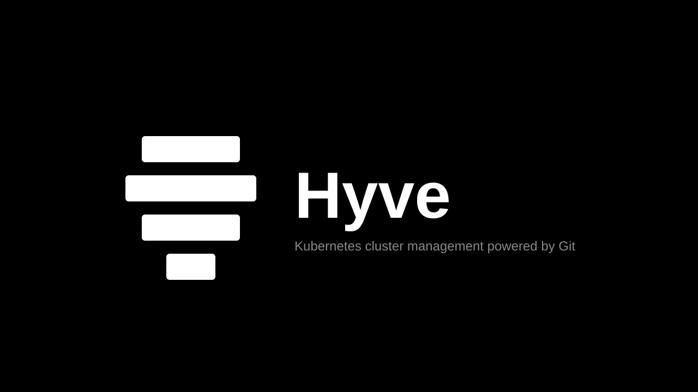

<p align="center">
  
</p>

# Hyve

Kubernetes clusters from templates. A **ClusterTemplate** is a Cluster API ClusterClass with defaults, locked variables, an expiry schedule and the resources every cluster made from it gets. hyve makes clusters from templates with [Cluster API](https://cluster-api.sigs.k8s.io/) and delivers their resources with [Fleet](https://fleet.rancher.io/). It runs alongside Rancher, or acts as the Rancher host itself when Rancher isn't installed.

[](LICENSE)

## How it works

- **Clusters** are Cluster API `Cluster`s in an environment (a namespace). One labelled `hyve.io/template` is filled in from its template when it's created, whether that's by the CLI, `kubectl`, GitOps or the UI. The template's locked variables stay locked.
- **Templates** live beside their ClusterClass. Each template resource is Fleet's own `HelmOp`, `Bundle` or `GitRepo` spec. hyve-controller turns it into a Fleet object aimed at the template's clusters, and CAAPF carries it to every environment. A cluster can also have its own extras (`ClusterResource`s).
- **Secrets** are plain Kubernetes Secrets. A resource names the Secrets it needs, and Fleet copies them to its clusters. hyve holds no values, so fill the Secrets however your install manages them.
- **Expiry**: hyve-controller deletes a cluster when its `hyve.io/expires-at` passes, set from the template's schedule or `--ttl`.
- **Signing in**: `hyve login <url>` works against a hyve host or Rancher. Every command then reaches the management cluster through `<url>/k8s/clusters/local` as you, and `hyve cluster kubeconfig` gives kubectl access to a cluster the same way.

## Install

```bash
go install github.com/cbridges1/hyve@latest
helm install hyve deploy/helm/hyve -n hyve-system --create-namespace    # hyve-controller
# without Rancher, also the host endpoint:  --set host.enabled=true
```

The management cluster needs Cluster API, Fleet and CAAPF (Rancher with Turtles brings all three).

## Quick start

```bash
hyve login https://hyve.example.com
hyve env create dev && hyve env use dev
hyve template create capd-small --class capd --workers 1 --schedule "0 20 * * *"
hyve template resource add capd-small --helm podinfo --repo https://stefanprodan.github.io/podinfo --version 6.7.1
hyve cluster create demo -t capd-small
hyve resource status demo
hyve cluster kubeconfig demo > demo.yaml
```

`hyve render -f template.yaml -f class.yaml` prints what a template produces without touching a cluster. `hyve import` converts old hyve Templates and herd ClusterTemplates.

## Development

```bash
task build          # build the binary
task check          # go vet + tests
```

The design is in nexus-config's `docs/HYVE-PROPOSAL.md`.
